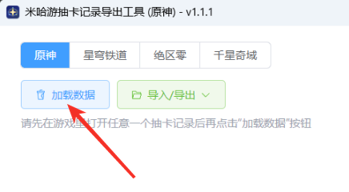

# 米哈游抽卡记录导出工具 (HoYo Gacha Export)

简体中文 | [English](./docs/README_EN.md)

基于 Electron + Vue 3 构建的米哈游四合一抽卡记录导出工具，支持 **《原神》**、**《崩坏：星穹铁道》**、**《绝区零》** 与 **《千星奇域》**（颂愿）。通过读取游戏本地日志或代理抓包获取记录链接，本地合并增量数据并导出为 Excel 或 UIGF JSON。

## 主要功能

- **四款游戏一站管理**：顶部标签一键切换《原神》《星穹铁道》《绝区零》《千星奇域》，各游戏数据、账号与配置自动隔离（兼容旧版单游戏数据自动迁移）。
- **多格式导入导出**：
  - 导出 **Excel (`.xlsx`)**：分卡池工作表 + 原始数据表，含保底统计与星级着色。
  - 导出 **UIGF v4.2 / v3.0**：支持跨游戏勾选多个 UID 合并导出 UIGF v4.2 JSON。
  - 导入兼容：支持 **UIGF v4.0–v4.2**、**UIGF v3.0**、**SRGF v1.0** 及旧版 `gacha-list-*.json`。

## 使用说明

1. 从 [GitHub Releases](https://github.com/h-void/hoyo-gacha-export/releases) 下载对应平台版本并解压。
2. 打开对应游戏的**抽卡历史记录 / 跃迁详情 / 调频详情 / 千星奇域颂愿历史**页面。
3. 在工具顶部选择对应游戏，点击「**加载数据**」按钮：

   

   如果日志模式未获取到链接，可在右上角「**选项**」中开启代理模式，再重新打开游戏内抽卡记录页面。
4. 加载完成后点击「**导入/导出**」即可导出数据；如需导出同游戏多个账号，点击 UID 旁的 `+` 按钮，在游戏内切换账号并打开历史页面后再次点击「**加载数据**」。

## 开发与构建

需要 Node.js (>= 22 LTS) 与 Yarn：

```bash
yarn install        # 安装依赖
yarn dev            # 开发模式
yarn test           # 运行单元测试
yarn build:app      # 编译构建产物
yarn build:win64    # 打包桌面端（另有 build:win32 / build:linux / build:mac）
```

<details>
<summary>更新内置《星穹铁道》与《绝区零》物品 ID 映射表</summary>

需要 Python 3（`requests`、`opencc`）：

```bash
python tools/getIdMap.py --game all
```

</details>

## 致谢与上游项目

本项目基于以下开源项目整合与二次开发，完整保留原作者版权声明：

- **[@biuuu](https://github.com/biuuu)** — [`genshin-wish-export`](https://github.com/biuuu/genshin-wish-export) (`MIT License, Copyright (c) 2021 biuuu`)、[`star-rail-warp-export`](https://github.com/biuuu/star-rail-warp-export) (`MIT License, Copyright (c) 2023 biuuu`)
- **[@earthjasonlin](https://github.com/earthjasonlin)** — [`zzz-signal-search-export`](https://github.com/earthjasonlin/zzz-signal-search-export) (`MIT License, Copyright (c) 2024 earthjasonlin`)
- **[@Scighost](https://github.com/Scighost)** — [`Starward`](https://github.com/Scighost/Starward) (`MIT License`)
- **[@GoneTone](https://github.com/GoneTone)** — [`genshin-impact-wish-gacha-analyzer`](https://github.com/GoneTone/genshin-impact-wish-gacha-analyzer) (`MIT License`)
- **[@sunfkny](https://github.com/sunfkny)** — [`genshin-gacha-export-js`](https://github.com/sunfkny/genshin-gacha-export-js)
- **[UIGF-org](https://uigf.org/)** — 统一可交换抽卡记录标准 (UIGF / SRGF)

## License

[MIT](./LICENSE)
