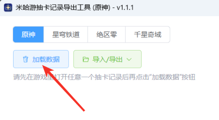

# HoYo Gacha History Exporter

[中文](../README.md) | English

This project integrates and adapts [genshin-wish-export](https://github.com/biuuu/genshin-wish-export), [star-rail-warp-export](https://github.com/biuuu/star-rail-warp-export), and [zzz-signal-search-export](https://github.com/earthjasonlin/zzz-signal-search-export) into a single tool for **Genshin Impact**, **Honkai: Star Rail**, **Zenless Zone Zero**, and **Miliastra Wonderland**.

A tool made with Electron for Windows, macOS, and Linux.

Read the game log or proxy to get the authKey needed to access the game gacha history API, and then use the authKey to read the gacha history.

The tool saves data by game in the `userData` folder and merges with local data when new records are obtained (supports Excel and cross-game UIGF v4.2 JSON export).

## Usage

1. Unzip after downloading the tool - [Download](https://github.com/h-void/hoyo-gacha-export/releases)
2. Open the in-game Wish / Warp / Signal Search / Miliastra Wonderland Ode History page
3. Select the corresponding game at the top and click the tool's "Load data" button

   

   If nothing goes wrong, you'll be prompted that data is being read. If the link cannot be found from logs, enable proxy mode in "Options" (top right) and reopen the in-game history page.

If you need to export the data of multiple accounts, you can click the plus button next to it.

Then switch to the new account in the game, open the history page, and click the "Load data" button in the tool.

## Development

```bash
# install node modules
yarn install

# develop
yarn dev

# build a program that can run
yarn build
```

## Credits

- [@biuuu](https://github.com/biuuu) — [genshin-wish-export](https://github.com/biuuu/genshin-wish-export) / [star-rail-warp-export](https://github.com/biuuu/star-rail-warp-export) (`MIT License`)
- [@earthjasonlin](https://github.com/earthjasonlin) — [zzz-signal-search-export](https://github.com/earthjasonlin/zzz-signal-search-export) (`MIT License`)
- [@Scighost](https://github.com/Scighost) — [Starward](https://github.com/Scighost/Starward) (`MIT License`)
- [@GoneTone](https://github.com/GoneTone) — [genshin-impact-wish-gacha-analyzer](https://github.com/GoneTone/genshin-impact-wish-gacha-analyzer) (`MIT License`)
- [@sunfkny](https://github.com/sunfkny) — [genshin-gacha-export-js](https://github.com/sunfkny/genshin-gacha-export-js)
- [UIGF-org](https://uigf.org/)

## License

[MIT](../LICENSE)
